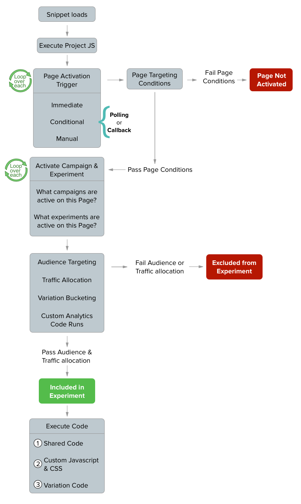

# [Optimizely Web Experimentation JavaScript snippet](https://docs.optimizely.com/web-experimentation/docs/optimizely-web-experimentation-javascript-snippet)
create experiments and campaigns on your site by executing a one-line JavaScript snippet that contains your unique project ID

# Snippet Order if Activation

# Project vs Shared vs Custom Code
## [Project Script](https://docs.optimizely.com/web-experimentation/docs/u04X-project-settings-jquery-and-project-javascript-settings#project-javascript)
- run code before the Optimizely Web Experimentation code snippet without having to change your native site's code
- Common use cases for Project JavaScript include:
  - Reusing custom modules, such as lightboxes and banners, across multiple experiments.
  - Running experiments on single-page apps that happen without reloading the page.
  - Targeting more than one experiment to the same audience.

## [Shared Code](https://docs.optimizely.com/web-experimentation/docs/zicH-shared-code-run-custom-javascript-and-css-across-all-variations)
- Can apply it to an entire experiment across all variations
- Add functions that can be used across multiple variations and call them with different parameters in the variation code
- Shared JavaScript evaluates first after a visitor is bucketed into the experiment and is run across all variations within the experiment or campaign

## [Custom Code](https://docs.optimizely.com/web-experimentation/docs/custom-code)
- Can apply it at the variation level
- Load an external JavaScript file as part of a variation
- You cannot add code that includes a <script> tag, but you can paste external JavaScript into the <Edit Code> box

# Use templates
You should use templates instead for these situations
- Reuse custom modules, like lightboxes or banners, across multiple experiments. Use editor templates.
- Add functions to use across multiple variations and then call them with different parameters in the variation code. The better approach depends on the context. Custom code or project Javascript can be used for ad-hoc, but Optimizely Web Experimentation also provides editor templates that offer more reusable options in cases like this.

